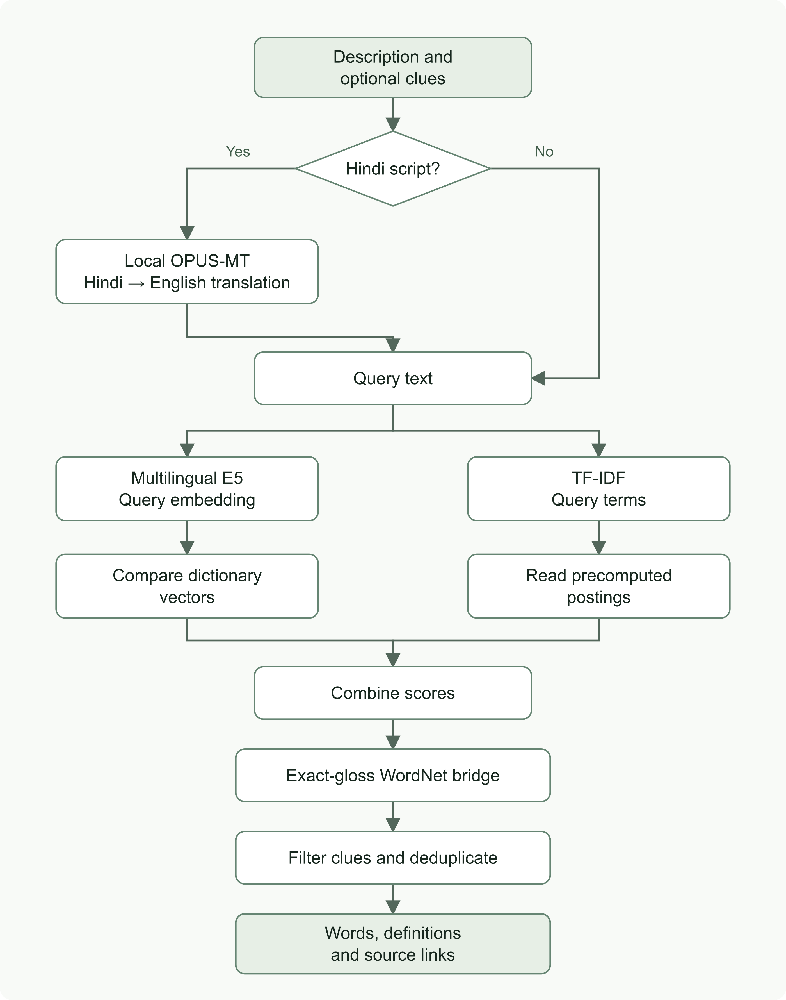

# ShabdAnveshi · शब्दान्वेषी

**[🌐 Visit the live website](https://rohan-ktksu.github.io/shabdanveshi/)**

*Describe the thought. Discover the word.*

A bilingual reverse dictionary for moments when you remember a meaning but cannot recall the word. Describe a person, feeling, object or idea in English or Hindi, and search real dictionary entries for possible matches.

[API documentation](https://shabdanveshi-api.vercel.app/docs) · [LinkedIn](https://www.linkedin.com/in/rohansai0907)

The React frontend runs on GitHub Pages and the Python API on **Vercel Hobby**, migrated from Render Free on **22 October 2026**. This is an academic prototype: ambiguous descriptions, missing vocabulary and translation errors can affect results. Free hosting has usage limits and cold starts; latency varies.

## Our journey

### 1. An assignment became a practical idea

The project began as a Natural Language Processing assignment on **Similar Word Prediction**. We chose a **Tip of the Tongue Finder**: reverse the usual dictionary question, describing a meaning to recover a word. The initial work centred on a Python implementation, an assignment report, a pipeline diagram, and notebook-style code and results.

The next question was whether it could handle more than a short list of examples. That led to dictionary corpora and semantic retrieval. A larger corpus expands the search space, but does not guarantee an answer for every possible context.

### 2. Naming and designing the website

After exploring English and Indian-language names, the project became **ShabdAnveshi**, reflecting the search for words. Several interface concepts were considered; the green **Quiet Conversation** design was selected.

The interface puts the description box at the centre, the logo on the left, and language/settings controls on the right. First-time visitors choose English or Hindi. The About page explains the motivation, journey, libraries, search logic and creator details, with LinkedIn and repository links. [The original design reference](designs/concepts.html) is a preview artifact, not the deployed application.

### 3. Building the interface and API

We used **React, TypeScript and Vite** for the frontend and **Python with FastAPI** for the backend. GitHub Pages serves the static frontend; the Python API initially ran on Render and now runs on Vercel Hobby.

Interface language and result language are independent: a user can keep the interface in English, type Hindi, and request English, Hindi or both kinds of words. Starting letters, approximate length and part of speech provide optional clues. Sample conversations are explicitly illustrative; real searches call the API.

Meaningful implementation stages were committed separately. The local project and its development resources are maintained at **D:\sem 5\ShabdAnveshi**. Large generated data, model weights and dependencies are excluded from Git.

### 4. Preparing the dictionary corpus

The prepared index contains **150,041 word senses**, not 150,041 unique words:

| Source | Language | Senses |
| --- | --- | ---: |
| WordNet 3.0 | English | 117,659 |
| Hindi Wiktionary extracted through Kaikki | Hindi | 32,382 |

Hindi headwords in this dataset have **English glosses**, labelled in the interface. Results retain their definitions and source attribution.

Preparation downloads source data and pinned model resources, constructs dictionary records, and encodes descriptions into 384-dimensional multilingual E5 vectors. It uses query/passage prefixes, masked mean pooling and normalization. Checkpoints allow interrupted preparation to resume when resource hashes match.

### 5. Testing the first retrieval pipeline

The first system combined semantic similarity with a small TF-IDF contribution. English examples often worked, but Hindi descriptions exposed weaknesses, especially around negation.

We evaluated 20 diagnostic descriptions with fixed expected answers. The baseline placed an expected answer first in **8/20** cases and within the first five in **13/20**. This separated retrieval quality from whether an API request merely succeeded.

### 6. Improving Hindi search

Two changes improved retrieval:

- **Local OPUS-MT translation:** Hindi-script descriptions are translated into English before search. The interface shows the interpreted text so translation mistakes can be noticed. Searches do not call an external translation API.
- **Exact-gloss WordNet bridge:** Hindi entries whose English gloss segments match a WordNet lemma or alias of the same part of speech can inherit that sense's retrieval score. Displayed definitions and attribution remain attached to the original entry.

| Pipeline | Expected answer first | In first five |
| --- | ---: | ---: |
| Original baseline | 8/20 | 13/20 |
| Improved full runtime | 10/20 | 16/20 |
| Final compact runtime | 11/20 | 16/20 |

The corpus contained an expected answer for **19/20** cases; *petrichor* was absent. The expected-answer lists remained unchanged. Because these cases guided improvements, these numbers are **development diagnostics, not held-out accuracy estimates**. Negation remains difficult, and translation can lose meaning.

See [validation notes](backend/VALIDATION.md), [baseline results](backend/evaluation.json) and [compact results](backend/evaluation-compact.json).

### 7. Fitting the system into free hosting

The improved in-process backend measured roughly **1.15 GB of memory on Windows**. Keeping hosting free required a different runtime layout:

- SQLite stores dictionary records and term metadata.
- Dictionary vectors are exported as int8 with normalization data.
- TF-IDF postings are precomputed; arrays are memory-mapped from disk.
- Translation and embedding run in separate Python processes; their models never overlap. Initially every process was short-lived; the later speed update can retain the encoder when memory permits.
- Vector scoring happens in chunks, and mapped arrays close after each search.

This trades speed for lower resident memory. Full resources remain useful for preparation and comparison; production uses the compact export.

A GitHub Actions workflow prepares the assets and tests the API in a Docker container capped at **512 MB, with no extra swap**. It publishes an archive and SHA-256 checksum only after repeated search checks succeed. [The runtime-1 release](https://github.com/Rohan-Ktksu/shabdanveshi/releases/tag/runtime-1) passed that check. This verifies the tested workload, not unlimited traffic capacity.

### 8. Deployment and the production timeout fix

We created a **Render Blueprint** from the repository, explicitly using its **Free** plan. Startup downloads the versioned archive and verifies its checksum before extraction. The frontend receives the API address through the public GitHub Actions variable `VITE_API_URL` and builds with the `/shabdanveshi/` base path. CORS allows the GitHub Pages origin.

Real production testing found a problem that local testing missed: Hindi translation on the free CPU exceeded the original **20-second worker timeout**. We raised the worker limit to **90 seconds** and the frontend request limit to **180 seconds**, committed the fix, and deployed both services again.

The live description **“किताबों से प्रेम करने वाला व्यक्ति”** was then interpreted as **“A Lover of Books”** and returned **bibliophile** first. That request took about **39 seconds**. An English book-lover query also returned bibliophile first. These are observed examples, not guarantees for every description.

### 9. Reducing repeated work during searches

The compact runtime was reloading the embedding model for every description. The speed update reuses a single encoder worker when the Linux memory budget allows it, while still closing it before a new Hindi translation. A conservative memory check releases the encoder when space is tight; `SHABD_WARM_ENCODER=0` disables retention. Translation and embedding never coexist as loaded models.

Keeping the worker loaded on Render's 512 MB instance exposed memory pressure. The API was migrated to **Vercel Hobby**, whose Python functions have 2 GB RAM and one vCPU. The original tokenizer, model weights and ranking rules are preserved. Unused native heap pages are returned to Linux, and the worker remains subject to a memory-headroom check.

Bounded, process-local caches reuse translations, embeddings, scores and final suggestions for up to ten minutes. Changing result language or clues reuses scores but applies all filters again. Queries stay in server memory rather than a disk cache. Common searches now fetch ranked dictionary rows in batches instead of scanning every entry; prefix searches still check headwords and aliases across the dictionary.

The browser also requests API health once when the page opens, starting initialization while the visitor chooses a language or types. Function instances and their caches can be recycled, so the first search after a cold start can still be slower.

On **22 October 2026**, a sequential local run measured approximately **1.61 s** for the first English description, **0.17 s** for a different description with the encoder warm, and **under 1 ms** for repeated English/Hindi searches. The first Hindi search still took **2.97 s** locally. These are direct Python timings, excluding HTTP and hosting delays; see [measurements](backend/performance-local.json). The same fixed 20-case evaluation is recorded in [results after optimization](backend/evaluation-performance.json).

The separate **2 GB runtime check on pushes and pull requests** passed using the existing verified `runtime-1` assets. It checks startup, repeats, distinct queries, Hindi model switches and a maximum-length description. All 20 result lists matched the original code on the same Linux runner, with no OOM kills. See [the successful check](https://github.com/Rohan-Ktksu/shabdanveshi/actions/runs/39793080917). Quantized inference can vary across CPUs: the Linux diagnostic counted 10/20 first answers and 16/20 first-five answers, while Windows counted 11/20 and 16/20.

The Vercel build bundles the checksum-verified assets, so cold requests do not download them. Live sequential HTTP measurements after a health request were:

| Search | Vercel Hobby observed time |
| --- | ---: |
| First English description | 2.97 s |
| Different English description, warm encoder | 0.41 s |
| Repeated English description | 0.95 s |
| First Hindi description | 3.37 s |
| Repeated Hindi description | 0.09 s |

The [earlier Render measurements](backend/performance-render-before.json) for the first English and Hindi examples were 14.56 s and 38.46 s. These are individual observations, not a controlled benchmark or a latency guarantee. Vercel HTTP timings include network delay and do not measure a full cold start; [raw measurements](backend/performance-live.json) also record server processing times. New Hindi descriptions still load translation separately, and weak Hindi suggestions remain possible. Render auto-deploy is disabled; its Free service is retained as a temporary fallback. No paid plan was selected.

## How a search works

[](docs/search-pipeline.svg)

[View the full-size pipeline](docs/search-pipeline.svg). Hindi descriptions are translated locally before retrieval; other descriptions go directly to query encoding. Optional clues are applied after scoring and bridge propagation.

Before bridge propagation, ranking uses:

```text
ranking score = semantic cosine similarity + 0.05 × TF-IDF cosine similarity
```

**Semantic similarity** compares meaning through embeddings. **TF-IDF** adds evidence from shared words and phrases. The weight is an initial choice, not a calibrated probability. The API's `score` and `semantic_score` fields report semantic similarity; they need not decrease strictly in final rank order after lexical scoring and bridge propagation.

Language and part-of-speech filters are exact. Prefixes use Unicode normalization and case folding. Approximate length allows ±1 letter-containing grapheme cluster, avoiding counting Hindi combining marks as separate visible letters. Duplicate word/language pairs are removed.

## Technology

| Technology | Responsibility |
| --- | --- |
| React + TypeScript | Chat, results, language preferences, About and settings |
| Vite + Lucide React | Production builds and interface icons |
| Python + FastAPI + Uvicorn | Request validation and HTTP API |
| multilingual-e5-small + ONNX Runtime + Tokenizers | Quantized multilingual semantic inference |
| OPUS-MT Hindi–English + SentencePiece | Local translation and tokenization |
| scikit-learn | TF-IDF preparation and full reference runtime |
| NumPy + SQLite | Compact vectors, postings, ranking and dictionary lookup |
| regex | Unicode-aware clue handling |
| Docker + GitHub Actions | Runtime packaging, checks, asset builds and deployment |
| GitHub Pages + Vercel Hobby | Static frontend and Python backend hosting |

## Run locally

Use **Python 3.12** and **Node.js 22.12+**. The commands below assume the existing D-drive checkout. Corpus/model preparation downloads substantial resources and can take time.

```powershell
cd "D:\sem 5\ShabdAnveshi"
python -m venv .venv
.\.venv\Scripts\python.exe -m pip install -r backend\requirements.txt --cache-dir .pip-cache
.\.venv\Scripts\python.exe -m backend.prepare
.\.venv\Scripts\python.exe -m backend.build_compact
$env:SHABD_ENGINE = "compact"
.\.venv\Scripts\python.exe -m uvicorn backend.main:app --host 127.0.0.1 --port 8000
```

In a second terminal:

```powershell
cd "D:\sem 5\ShabdAnveshi\frontend"
npm ci
npm run dev
```

Before starting Vite, create `frontend/.env.local` with `VITE_API_URL=http://127.0.0.1:8000`. Restart Vite after changing it. `VITE_` values are public configuration, never secrets. For a new all-D-drive setup, direct package caches and temporary downloads to D: as well.

More details: [frontend guide](frontend/README.md), [backend guide](backend/README.md), [deployment guide](DEPLOYMENT.md).

## Checks and workflows

| Verification | What it establishes |
| --- | --- |
| 28 Python unit tests | API contracts, filters, bridge, caches and worker lifecycle |
| TypeScript + Vite build | Frontend type correctness and production bundling |
| Fixed 20-case evaluation | Diagnostic retrieval quality and coverage |
| 2 GB Docker smoke test | Tested requests complete within the new host's limit and match the original results on the same platform |
| Live API and browser checks | Public delivery, CORS, onboarding and real search behaviour |

Run unit tests with `python -m unittest backend.test_api backend.test_retrieval backend.test_bridge backend.test_performance -v`. With resources prepared, run `python -m backend.evaluate --compact` for retrieval evaluation and `python -m backend.benchmark` for sequential latency checks. Run `npm run build` from `frontend/` to build the interface.

- **Project checks** runs on pushes and pull requests: frontend build, fixture-based backend tests, and a separate runtime container check using the published compact assets. It does not rebuild the corpus.
- **Build and verify runtime assets** manually prepares, tests and publishes model/index assets.
- **Deploy frontend to GitHub Pages** manually checks API readiness, builds and publishes the frontend.
- **Vercel** builds the FastAPI backend and bundles the checksum-pinned model/index archive. The initial production deployment was published through the authenticated CLI. Native Git auto-deploy is still pending: Vercel reports a missing GitHub login connection despite the account showing connected. Until resolved, use `vercel deploy --prod` from the linked project. The free Hobby plan has monthly limits; usage can be paused when those limits are reached. Render remains a temporary manual fallback.

## Limitations and lessons

- Dictionary coverage bounds the answers. The system cannot reliably recover every word from every context.
- Hindi retrieval remains experimental; negation, ambiguity and translation errors can produce weak suggestions.
- Hindi entries currently have English definitions. Full Hindi definitions are not implemented.
- Similarity scores are not confidence percentages.
- Free hosting brings cold starts and slow inference. A longer timeout allows more time; it does not make the model faster.
- One inference request is admitted at a time. Busy requests receive HTTP 429; unavailable resources or inference failures return errors rather than fabricated answers.
- Successful builds and health checks do not establish search quality. The production Hindi test exposed the timeout issue.
- Future work could include broader held-out evaluation, better negation handling, richer Hindi lexical data and latency improvements measured within the memory budget.

## Repository map

```text
frontend/               React interface and setup guide
backend/                API, preparation, retrieval, tests and evaluation
backend/licenses/       Third-party resource licenses
.github/workflows/      Checks, asset build and Pages deployment
designs/                Original interface concepts
Dockerfile              Production Python container
render.yaml             Free Render service configuration
vercel.json             Current Python function configuration
pyproject.toml          Python runtime and Vercel build entry point
DEPLOYMENT.md           Deployment procedure
```

## Creator and academic context

| Detail | Value |
| --- | --- |
| Name | Gorumutchu Rohan Sai |
| SRN | R24EJ042 |
| Class and section | CSIT A |
| Semester | 5th Semester |
| Subject | Natural Language Processing |
| Course code | B25EJS503 |
| Professor | Arati C |
| Assignment topic | Similar Word Prediction |

[GitHub repository](https://github.com/Rohan-Ktksu/shabdanveshi) · [LinkedIn](https://www.linkedin.com/in/rohansai0907)

Dictionary data and pretrained models have their own licenses. Read [resource attribution](backend/ATTRIBUTION.md) and [included licenses](backend/licenses) before redistributing assets. ShabdAnveshi uses existing pretrained models; it does not claim to have trained E5 or OPUS-MT from scratch.
